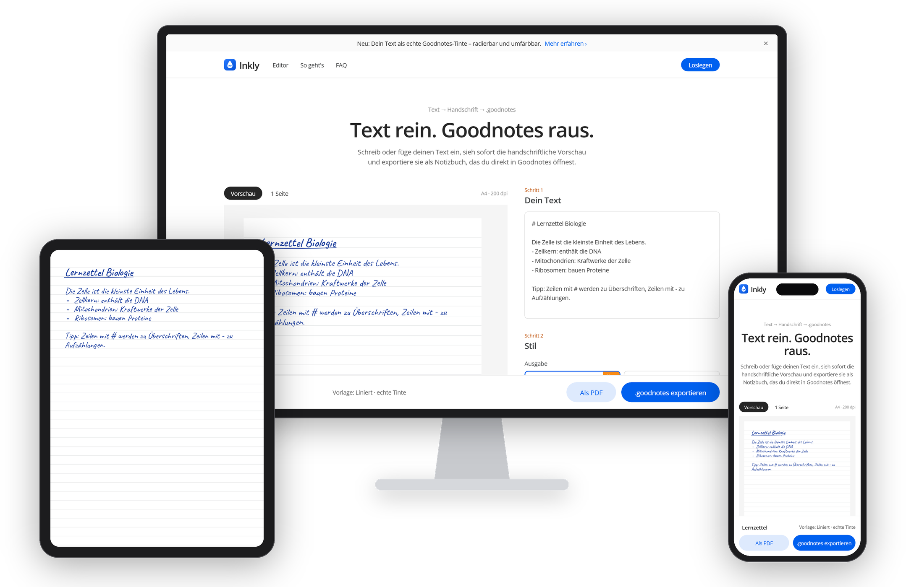

<hr>

<p align="center">
  <picture>
    <source media="(prefers-color-scheme: dark)" srcset="assets/logo-dark.svg">
    
  </picture>
</p>

<hr>

<p align="center">
  
</p>

<p align="center">
  <b>Text rein. Goodnotes raus.</b><br>
  Verwandle getippten Text in <b>echte, radierbare Handschrift</b> für <b>Goodnotes</b> – direkt im Browser.
</p>

<p align="center">
  
  
  
  
  
  <a href="LICENSE"></a>
</p>

---

## ✨ Was Inkly kann

| | |
|---|---|
| ✍️ **Echte Goodnotes-Tinte** | Jeder Buchstabe wird als echter Goodnotes-Stiftstrich gespeichert – **radieren, mit dem Lasso auswählen, verschieben, umfärben**, als hättest du selbst geschrieben. |
| 👀 **Live-Vorschau** | Tippen und sofort sehen, wie die Seite aussieht. Die Vorschau entspricht exakt dem Export. |
| 🖋️ **6 Handschriften** | Caveat, Kalam, Patrick Hand, Indie Flower, Shadows Into Light und Gochi Hand – mit einstellbarer Größe, Strichstärke und „Unregelmäßigkeit“. |
| 📓 **Originales Goodnotes-Papier** | Liniert, eng liniert, kariert oder blanko – die Linien kommen 1:1 aus echten Goodnotes-Notizbüchern. |
| 🎨 **Tintenfarben** | Blau, Schwarz, Grün oder Rot. |
| 📝 **Mini-Markdown** | `# Überschrift` wird unterstrichen, `- Punkt` wird zur Aufzählung – perfekt für Lernzettel. |
| 📄 **PDF-Export** | Alternativ als PDF oder als `.goodnotes` mit dem Text als Seitenhintergrund. |
| 🔒 **Privat** | Alles läuft lokal im Browser. Kein Server, kein Upload, kein Konto. |

---

## 🚀 Loslegen

Inkly ist eine statische Website ohne Build-Schritt.

```bash
git clone https://github.com/Benspiel/Inkly.git
cd Inkly
python -m http.server 5173
```

Dann <http://localhost:5173> öffnen, Text einfügen, Stil wählen und auf **„.goodnotes exportieren“** klicken. Die Datei auf iPad oder Mac öffnen – fertig.

> 💡 Längere Texte werden auf mehrere Seiten verteilt. Im Tinten-Modus entsteht dann pro Seite eine eigene `.goodnotes`-Datei.

---

## 🧠 Wie das funktioniert

Goodnotes hat kein offizielles Dateiformat zum Importieren von Handschrift. Inkly baut die Dateien deshalb selbst – auf Basis eines selbst entschlüsselten Formats.

```
 Text ──► Layout auf Papierlinien ──► Handschrift-Font rendern
                                              │
                                              ▼
                         Zeichen skelettieren (Zhang-Suen)
                         + Strichbreite per Distanztransformation
                                              │
                                              ▼
           Striche ──► Goodnotes-Strichformat ──► in echte Notizbuch-Hülle
                       (Protobuf + LZ4 "bv41")      einsetzen ──► .goodnotes
```

<details>
<summary><b>🔬 Das .goodnotes-Format im Detail</b></summary>

<br>

- Ein `.goodnotes`-Datei ist ein **ZIP-Archiv** mit Protobuf-Indexdateien (`index.*.pb`), einer PDF-Anlage für das Papier und einer Strichdatei pro Seite (`notes/<ID>`).
- Frei erfundene Archive lehnt Goodnotes ab („Missing document ID“). Inkly nutzt deshalb **leere, echte Goodnotes-Notizbücher als Hülle** (`templates.js`) und vergibt bei jedem Export **neue IDs** – so ist jede Datei ein eigenes Notizbuch.
- `notes/<ID>` ist eine Folge längenpräfixierter **Protobuf-Datensätze** – pro Strich ein Kopf (ID, Lamport-Uhr, Autor) und ein Inhalt (Farbe als RGBA, Punktdaten).
- Die Punktdaten liegen **LZ4-komprimiert im Apple-Rahmen** (`bv41 … bv4$`) in einem `tpl`-Block mit dem Schema `vuA(v)A(S(uu))A(S(uuuu))vA(f)`: Version, Breite, Segmenttypen, Startpunkt, quadratische Segmente.
- Koordinaten: Ursprung oben links, **1 PDF-Punkt = 11/6 Goodnotes-Einheiten** (A4 = 1091,35 × 1543,5).
- Die Index- und Ereignisdateien müssen für neue Striche **nicht** angepasst werden.

Die Python-Werkzeuge zum Untersuchen und Erzeugen von Strichen liegen in [`tools/ink/`](tools/ink/).

</details>

---

## 🗂️ Projektstruktur

```
├── index.html        # Oberfläche
├── styles.css        # Design (angelehnt an ein „Produkt-Showroom“-Designsystem)
├── app.js            # Layout, Rendering, Skelettierung, Goodnotes-/PDF-Export
├── templates.js      # Eingebaute leere Goodnotes-Notizbücher (Base64)
├── assets/           # Logo, Favicon, README-Bilder
└── tools/ink/        # Python: Strichformat dekodieren, prüfen, erzeugen
```

---

## ⚠️ Hinweise

- Inkly ist ein **inoffizielles** Projekt und steht in keiner Verbindung zu Goodnotes Ltd. „Goodnotes“ ist eine Marke der jeweiligen Inhaber.
- Das Dateiformat ist selbst entschlüsselt. Eine künftige Goodnotes-Version kann es ändern – dann bitte ein Issue aufmachen.
- Die Goodnotes-Suche findet den erzeugten Text eventuell erst, nachdem Goodnotes die Handschrifterkennung durchlaufen hat.

---

## 🙏 Danksagung

- Handschriften von [Google Fonts](https://fonts.google.com/) (SIL Open Font License)
- [JSZip](https://stuk.github.io/jszip/) zum Lesen und Schreiben der Archive
- [jsPDF](https://github.com/parallax/jsPDF) für den PDF-Export

---

## 📄 Lizenz

Der Code von Inkly steht unter der [MIT-Lizenz](LICENSE). Die Handschriften werden von Google Fonts geladen und stehen unter der SIL Open Font License; JSZip und jsPDF haben ihre eigenen Lizenzen.

<p align="center"><sub>Mit ✍️ und viel Reverse Engineering gebaut.</sub></p>
